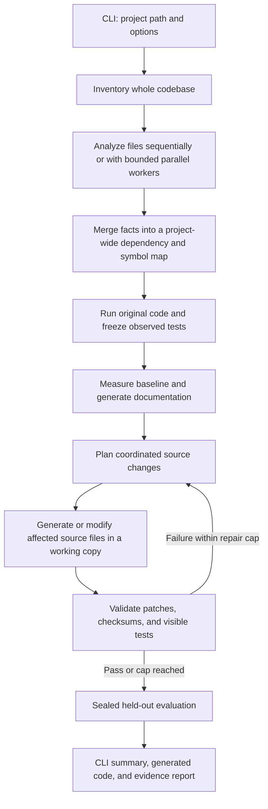

# CLI modernization tool: approach and implementation plan

**Status:** CP0–CP10 complete; CP1 and CP6 human gates approved. CP11 technical checks now pass in two clean checkouts under the documented cross-runtime policy, with raw rates retained separately. Its final human gate is awaiting approval.
**Foundation:** Small Python 2.7 projects upgraded to Python 3.12.
**Interface:** Command-line only. Read source files directly; OCR is unnecessary.

## 1. Short approach

Scan the entire project, understand how its files connect, record what the original
program does, document it, convert a working copy, and repair migration failures.
Update related source files together whenever a change affects their references
or behaviour. Deliver the resulting code, diffs, documentation, and recorded tests.



## 2. Whole-codebase analysis: both execution modes

1. Recursively inventory the project; record source, configuration, assets, and
   explicit exclusions such as version-control metadata and caches. Report
   unsupported files and out-of-root links; never silently skip a parse failure.
2. Parse every supported Python source file, including identified extensionless
   Python scripts, from an immutable snapshot using a Python 2-capable parser.
3. Extract functions, classes, signatures, comments, imports, approximate calls,
   scoped symbol references, and side-effect markers. This stage uses no LLM.
4. Merge file facts into one project index. Resolve cross-file imports, aliases,
   callers, and dependencies before proposing changes.

| Mode | Execution | Intended use |
|---|---|---|
| Sequential | One file at a time, in stable path order | Default; simplest debugging and small projects |
| Parallel | A configurable, bounded pool analyzes independent files from the same snapshot | Larger inputs; respect aggregate CPU and memory limits |

Both modes use the same analyzer and schema. Workers return per-file facts;
the controller sorts and merges them deterministically. Their normalized facts
and diagnostics must match, excluding execution metadata such as timing.
Dependencies are resolved after the merge, so parallel parsing does not lose
cross-file context. Source writes remain serialized and coordinated.

## 3. Coordinated changes across files

For each proposed change:

1. Identify the actual symbol and scope, then find its references and affected
   callers through the project index. Recheck the index after source changes.
2. Build one change set covering the definition, imports, aliases, call sites,
   keyword arguments, and any dependent logic that actually needs adjustment.
   Treat circularly dependent modules as a group.
3. Generate replacement source or new helper modules only within allowed source
   paths in a separate working copy. Keep the original snapshot untouched.
4. Check base-file hashes, validate the structured patch, compile/import in the
   modern sandbox, and run affected tests followed by the full visible suite.
   Publish the change set only as a whole; discard unsuccessful candidates.
5. Save diffs and reasons; verify test/fixture checksums before and after every
   source-editing stage. Bound repair attempts per function and per run.

**Example:** renaming exported `calculate_total` to `compute_total` updates its
definition in `billing.py`, imports and calls in `checkout.py`, and resolved uses
in `invoice.py` together. A local variable with the same spelling in an unrelated
function stays unchanged. Use syntax- and scope-aware edits, not global text
replacement. If frozen tests or external consumers depend on the old public
name, preserve a compatibility entry point or report the change as breaking.
The same applies to a shared variable: renaming `settings.retry_limit` must update
resolved accesses in other modules while preserving unrelated local variables.

For logic changes, inspect affected callers, argument names, return-value shapes,
and data flow; modify callers when required by the change contract. Dynamic
imports, reflection, string-based
lookups, and consumers outside the input codebase cannot always be resolved
statically: flag uncertainty and unresolved cases as **needs human review**.

## 4. What “fix bugs” means

| Workflow | Allowed change | Evidence |
|---|---|---|
| Required modernization | Generate or repair source so converted behaviour matches the original | Frozen characterization tests and separate held-out results |
| Requested corrective extension | Generate or change source and dependent code to satisfy a specified bug fix | A separate behaviour-change specification and regression suite; report intentional baseline differences |

The foundation preserves suspected bugs already present in the legacy program
and reports them. Automatic migration repair fixes problems introduced by
conversion. The user's request adds a separate corrective workflow for existing
bugs; implement it after the required foundation, without redefining its results
as behaviour-preserving modernization. AI cannot invent the intended answer:
the corrective specification must define it. Add corrective tests in a separate
test-authoring step; source-editing stages cannot modify either test suite or
the original fixtures. The original baseline remains available for comparison.

## 5. Proposed stack and boundaries

- **Python 3.12 + `argparse`:** CLI, configuration, controller, and JSON logging.
- **Language adapter:** common parse, entry-point, convert, and test interface;
  Python 2 is the only foundation implementation.
- **Python 2.7 `ast`/`tokenize` in the legacy container:** original-code analysis;
  parser workers exchange structured facts with the modern controller.
- **Docker:** separate Python 2.7 and Python 3.12 images; no execution network,
  read-only inputs, ephemeral scratch, resource limits, and wall-clock timeouts.
  Only the trusted controller writes exported artifacts to the host.
- **Pydantic + AI-client interface:** validate responses; provide a real provider
  and deterministic mock; enforce retry, timeout, token, and cost limits.
- **Workflow:** start with explicit Python stage functions. LangGraph is a
  proposed orchestrator option; LangChain is optional inside AI-assisted stages.
  Before adopting frameworks, record the justification against [AGENTS.md](AGENTS.md)'s
  direct-provider-SDK default. Python conditions control routing and repair caps.
- **Tests:** modern tool tests plus runtime-compatible execution and coverage
  harnesses. Pin legacy-compatible dependencies separately.
- **Artifacts:** workspace directories with JSON/JSONL run records, facts,
  docs, fixtures, patches, and usage logs. Keep held-out artifacts inaccessible
  to repair, including AI prompts and shared repair state.

## 6. Proposed CLI contract

The `modernize scan` commands are implemented at CP2. `run` and `fix` below
describe later interfaces and are not implemented yet. Parallel mode applies
to file analysis.

```bash
# Analyze every supported source file, one at a time.
modernize scan ./legacy-project --analysis sequential --output ./runs/scan

# Analyze the same snapshot with at most four workers.
modernize scan ./legacy-project --analysis parallel --workers 4 --output ./runs/scan-parallel

# Full modernization: observe, document, convert, repair, verify, report.
modernize run ./legacy-project --analysis parallel --workers 4 --output ./runs/demo

# Separate post-foundation extension for a specified existing bug.
modernize fix ./project --spec ./bug-fix.json --output ./runs/corrective
```

Print stage progress and a final report path. Return `0` only when the requested
workflow's checks pass; use documented nonzero exits for invalid input,
incomplete analysis, failed checks, or unresolved review. Logs and partial
artifacts remain available after failure. Output goes outside the input snapshot.

## 7. Implementation plan: preserve checkpoint order

This is a roadmap, not permission to execute later checkpoints early. Record
exact commands, outcomes, decisions, and gaps in [PROGRESS.md](PROGRESS.md) at each checkpoint.

| Checkpoint | Implementation and exit evidence |
|---|---|
| CP0: Foundation | Package and CLI skeleton; configuration/logging; artifact layout; adapter and mock AI interface; both runtime versions demonstrated; one test command with nonzero failure exit. |
| CP1: Corpus — human gate | 4–6 licensed/original projects covering every required migration hazard; all run in Python 2.7; coverage matrix and hand-checkable golden project; obtain corpus approval. |
| CP2: Analysis | Inventory, Python 2 parsing, schema, all required facts, scoped symbol index, import/call graph; sequential mode first, bounded parallel mode second; every corpus file parses and both modes yield matching facts. |
| CP3: Sandbox | Structured capture of values/errors/output/files; prove network denial, timeout termination, memory limits, outside-scratch write protection, and deterministic replay. |
| CP4: AI layer | Real provider, versioned prompts, schemas, bounded validation retries, timeouts/rate-limit handling, redacted logs, and usage accounting; demonstrate malformed-response failure with the mock. |
| CP5: Characterization | Original runtime supplies expectations; state coverage target before generation; bounded follow-ups, repeated replay, normalization/quarantine policy and report, mutation minimum, and sealed held-out subset. |
| CP6: Baseline — human gate | Record original-on-original and original-on-modern pass rates and failure causes; obtain baseline approval. |
| CP7: Documentation | Bottom-up tagged docstrings and module/package summaries; observed-behaviour cross-check; coverage or reasons for omissions; tests/fixtures unchanged. |
| CP8: Conversion | Mechanical rules followed by validated semantic changes; project-wide impact planning, coordinated patches, saved diffs/reasons, modern compile/import checks, and checksum proof. |
| CP9: Repair | Capped source generation/repair with related-file updates; refresh affected facts; affected/full visible tests; checksum proof; final held-out run; anti-gaming review; unresolved cases reported. |
| CP10: Reporting | Recompute all three pass rates from records; include coverage, exclusions, held-out results, diffs, repair counts, token/cost totals, docs, unresolved failures, and suspected legacy bugs. |
| CP11: CLI hand-off — human gate | One-command clean-checkout pipeline across the corpus; second run reproduces pass rates; setup/usage/limitations README and golden-project demo; obtain approval. |
| After CP11: Requested corrective extension | Add specified existing-bug fixes, separate corrective tests, and coordinated source generation; preserve original baselines and label all intended behaviour changes. |

CP12 remains a separate optional dependency-upgrade report after CP11 approval;
it recommends upgrades and never applies them. Java/PHP adapters remain future
work. Passing tests supports the recorded cases, not every possible execution.

**Current task:** Review CP11's two successful clean-checkout revalidation runs:
120/120 policy comparisons, including 16/16 fresh held-out cases; raw rates remain
38/120. Policy, two validated source repairs, fresh cohort, docs, golden demo and
evidence are delivered. Final human approval is pending. Arbitrary-project/provider
pipeline integration remains unimplemented. See PROGRESS.md for evidence and limits.
Completion evidence belongs in PROGRESS.md; this plan itself passes no checkpoint.
