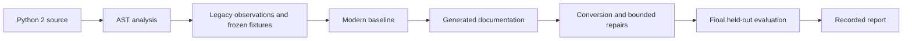

# CLI AgentForge Legacy

A command-line tool for studying and migrating small Python 2.7 projects to
Python 3.12. It extracts AST facts, records original behavior in characterization
fixtures, generates documentation, converts source, performs bounded repairs,
and reports the results against the original observations.

The Python package and terminal command are named `modernize`.

**Status:** CP0–CP10 are complete. CP11 technical checks pass for the approved
corpus under the explicit cross-runtime comparison policy; its final human
approval is pending. CP12 has not started. See [PROGRESS.md](PROGRESS.md) for
commands, evidence, decisions and limitations.

## What you can run

| Task | Entry point | Requirements |
|---|---|---|
| Open the guided terminal | `python -m modernize tui` | Controller dependencies; Docker for scans/runs |
| Validate configuration | `python -m modernize config` | Controller dependencies |
| Analyze a Python 2 project folder | `python -m modernize scan PROJECT --output OUTPUT` | Legacy Docker image |
| Run the complete registered corpus workflow | `python scripts/run_pipeline.py --output OUTPUT` | Repository checkout and both Docker images |
| Verify a saved pipeline run or compare two runs | `run_pipeline.py --verify OUTPUT` / `--compare FIRST SECOND` | Controller dependencies and saved run directories |
| Test the tool | `python scripts/test.py` | Controller dependencies; Docker checks are opt-in |

The installed `modernize` command exposes `tui`, `config` and `scan`.
The full pipeline is a repository script supporting the registered corpus IDs:
`golden_ledger`, `text_pipeline`, `ranking` and `file_report`. An arbitrary-folder
full migration command and live-provider pipeline selection are not implemented.
The OpenAI provider client exists separately; corpus runs replay recorded
LLM-authored proposals through the deterministic mock and need no API key.

## Setup

Run commands from the repository root. Requirements: Python **3.12 or later**,
Git, and Docker Desktop or a Docker Engine able to run Linux containers. Git is
used to record the source revision for pipeline runs. Recorded controller runs
used Python 3.12; the modern execution image targets Python 3.12.

After cloning this repository, change into its folder before running the commands
below. Create your own virtual environment and Docker images; local environments
and generated run folders are not included in Git. The mock corpus workflow needs
no API key.

```sh
python3 -m venv .venv
.venv/bin/python -m pip install -e .

PYTHONPATH=src .venv/bin/python -m modernize --help
PYTHONPATH=src .venv/bin/python scripts/run_pipeline.py --help
```

The package pins `openai==3.55.1` and `pydantic==2.14.3` in
[pyproject.toml](pyproject.toml). After installation, `modernize` is also available
at `.venv/bin/modernize`. The examples below set `PYTHONPATH=src` explicitly.

Start Docker, then build the two runtime images if they are not already present:

```sh
docker version
docker build -f containers/legacy.Dockerfile -t modernize-legacy:cp0 .
docker build -f containers/modern.Dockerfile -t modernize-modern:cp0 .
docker image inspect modernize-legacy:cp0 modernize-modern:cp0 --format '{{.Id}}'
```

Installation and image builds can need network access. Project execution uses
network-disabled sandboxes. Existing image identities and runtime version
outputs are recorded in PROGRESS.md; rebuilding a floating image tag may produce
a different image identity.

## Guided terminal

Launch the persistent command prompt:

```sh
PYTHONPATH=src .venv/bin/python -m modernize tui
# Equivalent after installation:
.venv/bin/modernize tui
```

Running `modernize` without arguments also opens it when stdin is a terminal.
Scripts with non-terminal stdin still require an explicit command.

The compact header shows the app, selected project and latest output location.
Press Enter at `modernize>` (or type `/menu`) to open the action menu. In a
supported POSIX terminal, use **Up/Down** and **Enter** to select; typing an option
number or name also works. Slash commands remain available at `modernize>`.
Non-terminal input and `TERM=dumb` use ordinary numbered prompts.

A live stage checklist shows **pending**, **active**, **done**, **failed** or
**cancelled** based on actual worker events. On short terminals it follows the
active stage; plain-text sessions print snapshots. A completed stage means the
stage finished, not that every migration test passed. Worker errors remain
visible. Navigation is cyan, success green, review amber, and errors red; text
labels carry the meaning when colors are disabled.

The result summary displays the selected comparison mode first, followed by raw
matches, policy passes and separate raw/policy held-out results. After a completed
interactive run, **Next action** offers **View report**, **Inspect changes**,
**Verify**, **Run again**, or **Return to prompt**. Run again requests a new output
folder; it never overwrites the previous run.

For a first migration, with Docker running and both images available:

1. Enter `/project golden_ledger` to select the small example.
2. Enter `/run` to open the guided migration prompts.
3. Select **golden_ledger**, then **python2-python3.v1**, using arrow keys or
   entering option numbers `1` and `2`.
   Strict remains the default; this walkthrough explicitly selects the
   [documented cross-runtime policy](docs/comparison-policy.md).
4. Enter a new output path, such as `artifacts/my-golden-run-1`, then choose `1`
   for **sequential** analysis. Use a different output path for each run.
5. Wait for the checklist and result summary, then select **View report** or
   **Inspect changes** from **Next action**. Press `q` to leave the pager.
6. Select **Verify** to check the saved evidence offline, then **Return to
   prompt**. `/review` also provides converted source and AST facts; `/verify`
   can reopen saved pipeline evidence. Enter `/quit` when finished.

Full runs use existing mock proposals and require a repository checkout.
Custom folders currently support scanning only: choose one with `/project`,
then use `/scan`.

| Command | Action |
|---|---|
| `/menu` or Enter | Open the numbered action menu |
| `/project` | Select a corpus example or custom Python 2 folder |
| `/scan` | Analyze the selected folder without executing its source |
| `/run` | Choose scope, comparison, output folder and analysis mode, then migrate |
| `/review` | Browse saved reports, diffs, converted source or facts |
| `/verify` | Check saved pipeline evidence offline |
| `/status` | Show the selected project and latest output |
| `/test` | Run unit tests, then integration tests |
| `/help` | Show commands grouped by task |
| `/quit` | Close the session |

Paths with spaces can be quoted after `/project`, `/scan`, `/review` or `/verify`,
or entered at their prompts.

Ctrl+C cancels a prompt or requests worker cancellation and waits for cleanup.
Interrupted runs retain partial artifacts and must not be treated as completed
runs. `/quit` or Ctrl+D exits. Selections and command history last for the current
session; artifacts persist on disk and can be reopened with `/review PATH` or
`/verify PATH`. Colors are enabled on supported terminals; plain-text output
remains available. To disable ANSI styling explicitly:

```sh
NO_COLOR=1 PYTHONPATH=src .venv/bin/python -m modernize tui
```

## Run a project and review its changes

Start with the golden project:

```sh
PYTHONPATH=src .venv/bin/python scripts/run_pipeline.py \
  --project golden_ledger \
  --comparison python2-python3.v1 \
  --output artifacts/golden-review-1
```

Every output directory must be **new**. Choose a different name for another run;
the pipeline refuses to overwrite existing outputs or protected inputs.
It prints stage progress and the final report path.

Review these files under `artifacts/golden-review-1/`:

| Path | What to review |
|---|---|
| `report.md` / `report.json` | Raw and policy results, coverage, quarantines, docs, diffs and unresolved cases |
| `run.json` | Checkout revision, settings, evaluation profile, stage and status |
| `facts.json` / `analysis-run.json` | Original Python 2 AST facts, project relationships and parser evidence |
| `golden_ledger/original/` | Original source snapshot |
| `golden_ledger/documentation/architecture.md` | Generated project explanation |
| `golden_ledger/repair/source/` | Final converted source |
| `golden_ledger/diffs/` | Final source changes against the documented legacy copy |
| `golden_ledger/repair/` / `golden_ledger/repair-llm/` | Repair proposals, validation, replays and call logs |
| `golden_ledger/heldout.json` | Final held-out observations |

For example, read the report in Terminal:

```sh
less artifacts/golden-review-1/report.md
```

Verify the saved run without executing project code again:

```sh
PYTHONPATH=src .venv/bin/python scripts/run_pipeline.py \
  --verify artifacts/golden-review-1
```

The golden demo script runs the same workflow and forwards additional options:

```sh
PYTHON=.venv/bin/python PYTHONPATH=src sh scripts/demo_golden.sh \
  artifacts/golden-demo-1 --comparison python2-python3.v1
```

To run all four corpus projects, omit `--project` or use `--project all`:

```sh
PYTHONPATH=src .venv/bin/python scripts/run_pipeline.py \
  --comparison python2-python3.v1 \
  --output artifacts/corpus-review-1
```

The pipeline accepts `--analysis sequential` (default) or
`--analysis parallel --workers 2`, with one to four workers. It analyzes the
whole corpus even when execution selects a single project.

## Comparison policy, exit codes and recorded results

The default comparison mode is **strict**. The explicit
`--comparison python2-python3.v1` option applies the
[documented policy](docs/comparison-policy.md) equally to original and converted
observations while retaining raw fixtures, raw pass flags and raw results.
It maps specified runtime representations and interpreter diagnostics. Binary
and text data, returned string contents, files, streams and unknown diagnostics
remain distinct.

Two clean-checkout final runs each exited `0` with these recorded results:

| Measurement | Result |
|---|---:|
| Converted code under the explicit policy | 120/120 |
| Fresh held-out cases under that policy | 16/16 |
| Converted code under raw comparison on the same cohort | 38/120 |
| Existing clock-dependent quarantines, excluded from those rates | 5 |

The final cohort retains old exposed cases as training/regression cases and adds
32 input-only proposals. Only fresh cases enter the final held-out subset.
Strict mode retains the original cohort; the report identifies which profile was
used. The different cohort sizes must be considered when comparing historical
rates. A policy pass does not establish byte-for-byte runtime identity or
behavior for every possible input.

Read the [final report](docs/reports/cp11-final/report.md),
[run evidence](docs/evidence/cp11-final.json) and
[pipeline guide](docs/pipeline.md). The earlier failed policy evaluation is
preserved in `docs/evidence/cp11-policy-v1-failed.tar.gz`.

| Pipeline exit code | Meaning |
|---|---|
| `0` | Execution passes its selected checks, or saved evidence verifies / compared rates match |
| `1` | Two verified runs have different pass rates |
| `2` | Invalid input, infrastructure error or failed stage |
| `3` | Execution saved its report with unresolved migrations or review flags |

Verification returning `0` means the saved evidence is consistent; it can verify
a report that correctly records failures. In strict mode, expect `3` for the
current corpus. Inspect `run.json` and retained partial records after errors.

## Scan your own legacy project

The analyzer accepts a Python 2 project directory without importing or executing
its code:

```sh
PYTHONPATH=src .venv/bin/python -m modernize scan \
  /path/to/legacy-project --output artifacts/custom-scan-1

PYTHONPATH=src .venv/bin/python -m modernize scan \
  /path/to/legacy-project --analysis parallel --workers 2 \
  --output artifacts/custom-scan-parallel-1
```

Outputs must be new and outside the input directory. `facts.json` contains
functions, classes, signatures, comments, imports, approximate calls, scoped
references and side-effect markers. `run.json` retains execution metadata and
failure details. Parse errors fail with exit `2`; files are not silently skipped.
See the [analysis schema](docs/analysis-schema.md).

This scan provides static analysis. Full conversion currently requires a corpus
entry and recorded input, documentation and transformation proposals. Follow
[adding a corpus project](docs/pipeline.md#scope-and-adding-projects), including
license/source provenance, proposal files, hazard coverage and explicit human
gates. The controller's own Python 3 source is not a Python 2 scanner input.

## Test the tool and inspect existing evidence

Run unit tests followed by integration tests, without live Docker execution:

```sh
.venv/bin/python scripts/test.py
```

The default suite includes offline evidence checks and intercepted SDK requests.
It fails on a failing or empty suite. Live sandbox security tests are skipped
unless explicitly enabled:

```sh
MODERNIZE_DOCKER_TESTS=1 .venv/bin/python scripts/test.py
```

Run the terminal's focused unit and integration checks with:

```sh
.venv/bin/python -m unittest discover -s tests/unit -p 'test_terminal*.py' -v
.venv/bin/python -m unittest discover -s tests/integration -p 'test_terminal*.py' -v
```

The current terminal checks pass **21 unit tests** and **5 integration tests**,
including real pseudoterminal arrow selection and input-mode restoration.

The latest full-suite command ran **110 unit tests**, with **1 failure** and
**1 skip**, then stopped before integration. The known failure is
`test_analysis_evidence.py:32`: it compares current CLI/analyzer source hashes
with the historical CP2 hashes. Its proposed provenance-test correction awaits
approval under AGENTS.md; no original assertion or recorded hash has been
changed. See [PROGRESS.md](PROGRESS.md) for the failure and verification evidence.

Before the terminal changes, the archived default suite recorded **104 tests**,
with **11 skips**; see
`test_suite` in [the final evidence record](docs/evidence/cp11-final.json).
That historical result is separate from current terminal checks and corpus
migration pass rates.

To verify and compare the committed final pipeline runs offline, extract their
archive into a new directory:

```sh
.venv/bin/python -m tarfile -e docs/evidence/cp11-final.tar.gz artifacts/saved-final-runs
PYTHONPATH=src .venv/bin/python scripts/run_pipeline.py \
  --compare artifacts/saved-final-runs/first artifacts/saved-final-runs/second
```

## Configuration

[config.example.json](config.example.json) defines `legacy_image`,
`modern_image` and `log_level`. Unknown keys and invalid values fail validation.

```sh
PYTHONPATH=src .venv/bin/python -m modernize \
  --config config.example.json config
```

For the package CLI, put the global `--config` before `tui`, `config` or `scan`. The
pipeline script also accepts `--config config.example.json`. Resolved package
configuration prints to stdout; structured configuration/analysis logs go to
stderr. See [LLM configuration](docs/llm-layer.md) for the separate provider
client's model, pricing, retries, usage accounting and redacted call logs.

## Architecture and repository layout



The Python controller chooses stages deterministically. The LLM boundary proposes
inputs, documentation and source patches; schemas, hashes, compile/import checks
and replay validate them. Python 2 parsing happens inside the legacy runtime.
All projects finish repair and lock their sources before final held-out execution.

Execution containers have no network, read-only roots, resource/time limits and
ephemeral scratch space. Input code receives no writable host mount. The trusted
controller alone exports artifacts. Tests and fixtures are protected by checksums;
source-editing stages receive training-only exports. See the
[sandbox policy](docs/sandbox.md).

| Directory | Responsibility |
|---|---|
| `src/modernize/` | Analysis, sandbox runner/workers, LLM interface/provider, characterization, docs, conversion, repair and comparison |
| `src/modernize/prompts/` | Versioned prompt templates and response schemas |
| `scripts/` | Fresh corpus pipeline, golden demo, individual checkpoint runners, verifiers and test command |
| `containers/` | Legacy/modern image definitions and runtime smoke script |
| `corpus/` | Four original MIT-licensed Python 2 projects, manifest and hazard matrix |
| `tests/` | Unit/integration tests and input-only proposal fixtures |
| `docs/evidence/` | Committed raw run archives, provenance and verification records |
| `docs/reports/` | Readable generated reports |
| `artifacts/` | Local generated runs; ignored by Git |

Agent/editor metadata folders such as `.agents/`, `.codex/`, `.claude/`,
`.cursor/` and `.planning/` are excluded from Git. Project source, tests,
documentation and recorded verification evidence are retained.

The individual checkpoint scripts in `scripts/` retain their historical behavior
and often consume committed earlier-stage archives. Use `run_pipeline.py` for
new outcomes through every stage. Detailed contracts:
[characterization](docs/characterization.md),
[documentation](docs/documentation.md),
[transformation](docs/transformation.md),
[repair](docs/repair.md), and [reporting](docs/reporting.md).

## Known limits and project status

- The complete repository workflow is corpus/mock-specific. The real provider
  client has offline SDK tests; autonomous live-provider conversion/repair quality
  and paid-run cost are not established by corpus replay.
- Five clock-dependent cases remain quarantined. Recorded mutation reanalysis
  detects 7/8 breaks, retaining a disclosed clock blind spot; the pipeline does
  not launch fresh mutation checks.
- Static call resolution is approximate. Custom numeric protocols, mixed-type
  ordering, dynamic behavior and unobserved inputs are outside the recorded claim.
  General conversion/test methods on the language adapter remain placeholders;
  current orchestration calls the implemented stage functions directly.
- Source review uses recorded coding-agent review plus heuristic scans.
  Offline verification checks record consistency, not execution authenticity.
- Suspected legacy bugs, including the corpus report builder's input overwrite,
  are preserved. Existing-bug correction is a separate future workflow.
- Java/PHP adapters and the optional dependency-upgrade report are future work.
  CP11's final approval remains pending; CP12 is not authorized.

See [PROJECT_PLAN.md](PROJECT_PLAN.md) for the roadmap and
[AGENTS.md](AGENTS.md) for the project rules.
